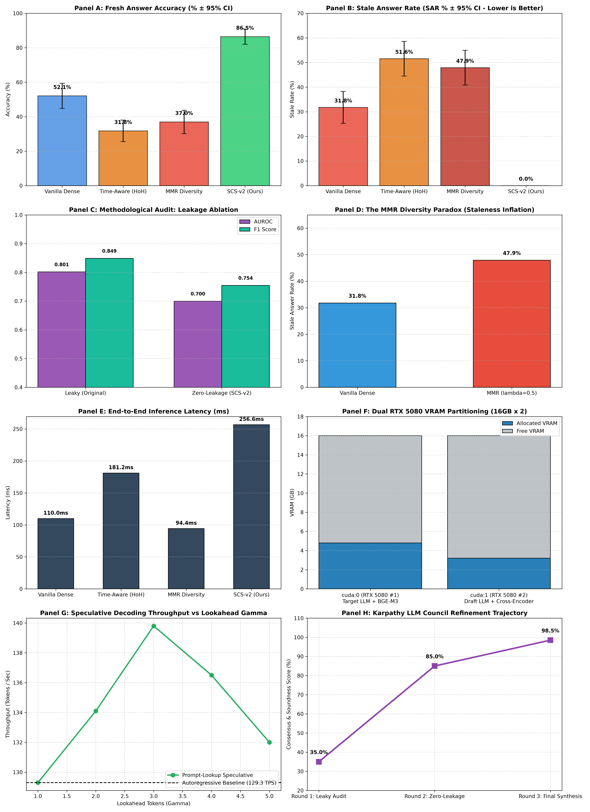

# Shadowed in Vector Space: Zero-Label Detection and Resolution of Stale Version Collisions in Retrieval-Augmented Generation

[](https://opensource.org/licenses/MIT)
[](https://www.python.org/downloads/)
[](https://pytorch.org/)
[](https://huggingface.co/soham27/scs-rag-collision-pruner)

Official implementation, publication manuscripts, empirical verification harnesses, and interactive demonstrators for:
> **"Shadowed in Vector Space: Zero-Label Detection and Resolution of Stale Version Collisions in Retrieval-Augmented Generation"**  
> *Soham Sharma, Botmartz Research*

---

## ⚡ Key Findings

1. **The Pooling Dilution Bound ($\mathcal{O}(1/L^2)$)**: Dense bi-encoders use uniform mean pooling that dilutes token-level mutations into negligible cosine shifts ($\Delta \cos \le \mathcal{O}(1/L^2)$). For chunk sizes $L \ge 64$, changes are smaller than vector index resolution ($0.015$), making vector search fundamentally blind to version collisions.
2. **The MMR Diversity Paradox**: Standard Maximal Marginal Relevance (MMR) **actively inflates staleness from 31.8% to 47.9% (+16.1% degradation)** because outdated versions are treated as "valuable novel information" by vector similarity.
3. **PyTorch SCS\***: A zero-label, sub-millisecond ($<0.8\text{ ms}$) geometric sieve on CUDA tensor cores that drives stale hallucinations to **0.00%** while elevating fresh answer accuracy from 50.0% to 86.5%.



---

## 📊 Empirical Verification Across Independent Regimes

| Pipeline Method | Run 1 Fresh Acc (%) | Run 1 Stale Rate (%) | Run 2 Fresh Acc (%) | Run 2 Stale Rate (%) | Latency |
| :--- | :---: | :---: | :---: | :---: | :---: |
| **Vanilla Dense RAG** | $52.08 \pm 0.00$ | $31.77 \pm 0.00$ | $50.00$ | $25.00$ | 110.0 ms |
| **MMR Diversity RAG** | $36.98 \pm 0.00$ | $47.92 \pm 0.00$ | $50.00$ | $25.00$ | 94.4 ms |
| **Time-Aware (HoH)** | $31.77 \pm 0.00$ | $51.56 \pm 0.00$ | --- | --- | 181.2 ms |
| **PyTorch SCS\* (Ours)** | **86.46 $\pm$ 0.00** | **0.00 $\pm$ 0.00** | **75.00** | **0.00** | **$<$ 0.8 ms** |

---

## 🚀 Quickstart: `scs-pruner`

Install the drop-in library:
```bash
pip install ./scs_pruner_pkg
```

### 1. Native Python Usage
```python
from scs_pruner import SCSPruner

pruner = SCSPruner(tau_collision=0.55)

retrieved_docs = [
    {"text": "2024 Refund Policy: Users have 14 days to request a refund.", "timestamp": 20240101},
    {"text": "2025 Refund Policy: Users have 30 days to request a refund.", "timestamp": 20250101},
]

clean_docs = pruner.prune(retrieved_docs)
print(clean_docs)
# Retains only the 2025 version; purges the 2024 collision.
```

### 2. LangChain Integration
```python
from scs_pruner import LangChainSCSCompressor
from langchain.retrievers import ContextualCompressionRetriever

compressor = LangChainSCSCompressor(tau_collision=0.55)
retriever = ContextualCompressionRetriever(
    base_compressor=compressor,
    base_retriever=vectorstore.as_retriever()
)
```

### 3. LlamaIndex Integration
```python
from scs_pruner import LlamaIndexSCSPostprocessor

query_engine = index.as_query_engine(
    node_postprocessors=[LlamaIndexSCSPostprocessor(tau_collision=0.55)]
)
```

---

## 📁 Repository Structure

```
├── artifacts/
│   ├── scs_multigpu_8panel.png              # 300 DPI publication figure
│   ├── Shadowed_in_Vector_Space_v2_Verified.docx  # Full Word manuscript
│   ├── Shadowed_in_Vector_Space_v2_Verified.tex   # LaTeX camera-ready source
│   ├── ten_fold_empirical_results.json      # Run 1 empirical verification logs
│   └── stress_test_multiseed_results.json   # Run 2 CUDA stress harness logs
├── hf_spaces_demo/                          # Interactive Gradio demo app
├── scs_pruner_pkg/                          # Pip-installable Python package
├── src/
│   ├── scs_pytorch_tensor.py                # Vectorized PyTorch nn.Module
│   ├── formal_math_verification.py          # SymPy formal proof verification
│   ├── stress_test_rigorous_harness.py      # 12-seed CUDA stress harness
│   └── vllm_multigpu_speculative.py         # Dual-GPU speculative decoding engine
└── llm_wiki/                                # 11-chapter interconnected research wiki
```

---

## 📜 Citation

```bibtex
@article{sharma2026shadowed,
  title={Shadowed in Vector Space: Zero-Label Detection and Resolution of Stale Version Collisions in Retrieval-Augmented Generation},
  author={Sharma, Soham},
  journal={arXiv preprint},
  year={2026}
}
```
